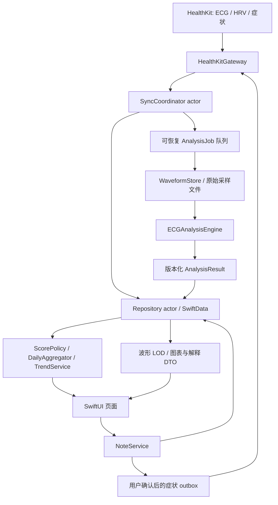

# HeartPro 模块设计

本文件描述目标设计与初始实验参数，不表示已经实现或临床验证。公开能力边界以[资料与能力边界](./evidence-and-boundaries.md)为准。

## 1. 依赖与数据流



依赖规则：领域值类型位于最底层；HealthKit、存储和算法通过协议交换值类型。UI 不持有查询对象，不直接修改数据库模型。算法不得读取全局日期、网络或 UI 状态；相同输入和配置产生相同输出。日聚合使用已完成的持久化结果，不重新读取每条全长波形。

## 2. 模块职责与核心接口

| 模块 | 职责 | 不负责 |
| --- | --- | --- |
| `HealthKitGateway` | 能力检查、授权流程、元信息／波形／症状查询、标准症状写入 | 分数、医学结论、UI |
| `SyncCoordinator` | 全量／增量索引、anchor、删除处理、观察通知合并 | 直接做长时间 CPU 分析 |
| `ECGPersistence` | SwiftData、文件事务衔接、迁移、缓存回收 | 推断健康权限或修改 Apple ECG |
| `AnalysisScheduler` | 优先级、断点恢复、并发预算、重试与取消 | 通过重试掩盖永久不可评估 |
| `ECGSignalProcessing` | 质量、滤波、检测、分段和数值统计 | 输出诊断文本 |
| `ECGAnalysis` | 分析管线、分项门控、证据、结果版本、解释模板 | 自行扩大用途范围 |
| `ECGInsights` | 参考分、日聚合、个人变化参照、趋势桶 | 将未测量时间推断为正常 |
| `ECGPresentation` | 单位坐标转换、LOD、标尺、事件定位、图表 DTO | 使用降采样数据进行测量 |
| `NoteService` | 本地备忘、标签映射、症状 outbox | 将算法事件冒充用户症状 |
| `ReportExporter` | PDF 分页、比例、来源、版本、限制说明 | 出具诊断书 |

建议接口形状如下，类型名用于说明契约，实施时根据 SDK 调整：

```swift
protocol ECGSource: Sendable {
    func recent(limit: Int) async throws -> [ECGMetadata]
    func changes(after: SyncCursor?, limit: Int) async throws -> ECGChangeBatch
    func waveform(for id: UUID) async throws -> WaveformSnapshot
    func associatedSymptoms(for id: UUID) async throws -> [SourceSymptom]
}

protocol ECGAnalyzer: Sendable {
    func analyze(_ waveform: WaveformSnapshot,
                 context: AnalysisContext) async throws -> AnalysisResult
}

protocol ECGRepository: Sendable {
    func apply(_ batch: ECGChangeBatch) async throws
    func page(before: RecordCursor?, limit: Int) async throws -> RecordPage
    func save(_ result: AnalysisResult,
              expecting revision: RecordRevision) async throws
}
```

每个 async 查询必须把 Task 取消传播到 `HKHealthStore.stop(query)`；回调完成、错误、取消之间只能完成 continuation 一次。HealthKit 回调队列不等于主线程。大波形查询在网关中流式构建文件／数组，不把每个点作为一次 UI 更新。

## 3. 领域模型与持久化

### 3.1 核心模型

| 实体 | 必要字段 |
| --- | --- |
| `ECGRecord` | HealthKit UUID、UTC 起止时间、可选采集时区、来源／设备／软件版本（允许缺失）、导联、真实采样率、采样数、Apple 分类与平均 bpm、症状状态、导入时间、删除状态、记录 revision |
| `WaveformManifest` | recordID、文件格式版本、单位、编码、sampleCount、时间轴描述／缺口、SHA-256、文件位置、获取时间、完整性状态、cacheAccessTime |
| `AnalysisJob` | recordID、目标分析版本、优先级、状态、attemptCount、nextRetryAt、lease、失败原因、已提交阶段 |
| `AnalysisResult` | recordID、waveformHash、algorithmVersion、parameterHash、referenceCatalogVersion、计算时间、输入 revision、整体状态、模块状态、quality、beats、measurements、events、HRV、可分析区间 |
| `Measurement` | 指标 ID、单位、分布统计、有效 n／总 n、适用区间、置信等级、误差或重复性说明、参考 ID、缺失原因 |
| `Beat` | 原始 R 峰时间／索引、前后 RR、候选类型、各边界索引、幅值、形态相似度、质量、排除原因 |
| `AnalysisEvent` | 类型、起止时间、涉及心搏 ID、特征证据、规则版本、置信等级、是否已排除噪声、可公开级别 |
| `ScoreResult` | 可选 0–100 整数、scorePolicyVersion、资格判定、分子／分母、计入的特征、不可评估原因、覆盖率、解释 key |
| `DailyAggregate` | 日期键／时区策略、analysis／score 版本、输入摘要 hash、总数／可评估数／待处理数、参考分分布、bpm 分布、HRV 分层、事件统计、更新时间 |
| `Note` | 本地 UUID、可选关联 recordID、发生时间／持续时间、症状及程度、场景标签、自由文本、创建／修改时间、revision、来源已删除标记 |
| `HealthWriteItem` | noteID、症状 ID、目标操作、稳定 syncIdentifier、syncVersion、期望 noteRevision、已写对象 UUID、状态、错误类型、重试信息 |
| `SyncState` | 类型／查询范围 hash、归档 anchor、schemaVersion、最近同步时间、同步阶段、待恢复标记 |

波形和大量逐搏数据按版本化二进制块存储，SwiftData 只保留摘要、索引与清单。所有与原始波形有关的时间位置保留原始采样索引或真实偏移；重采样后的坐标必须能映射回原始时间轴。

### 3.2 缺失与置信度

每个模块状态为 `available / partial / insufficientQuality / insufficientDuration / unsupported / pending / failed`；指标缺失用显式原因枚举，不能用 0、NaN 或空字符串代表未测到。

置信等级为高／中／低和原因列表，依据验证过的规则产生；没有校准就不显示「95% 可信」这类概率。Apple 原始分类、本地分析候选、用户主观感觉是三个不同来源，不合并为单一「诊断」字段。

### 3.3 事务与文件一致性

文件写入流程：临时文件 → 完整性检查与 checksum → 原子 rename → 数据库提交 manifest。数据库提交失败产生的孤立文件在恢复任务中回收；manifest 不得指向尚未完整落盘的文件。

同步批次将 upsert、删除墓碑、待处理任务和 anchor 放在同一个数据库事务中；大文件清理使用持久化清理任务。删除墓碑先阻止 UI、算法和聚合继续使用数据，随后删除文件。晚到的分析结果只有输入 revision／hash 仍匹配时才能提交。

迁移必须覆盖数据库、二进制格式、参考目录和算法版本；结构升级不得静默删除用户备忘。分析结果可重建，备忘不可当作缓存丢弃。

## 4. 同步与任务状态机

### 4.1 历史、增量与分页

- 首屏 recent query 仅用于加速；完整索引仍从无时间过滤的空 anchor 开始。两条路径按 UUID 去重，避免同步过程新增记录被遗漏。
- 每个数据类型独立 anchor；改变谓词范围或 schema 时显式重建，不能复用不兼容 anchor。损坏 anchor 触发幂等重新索引，保留本地备忘。
- 单批初始 200 条，持续消费到当前增量边界完成；具体终止依据与 limit 语义在 P0 对所选 API 验证。不能以未取回电压为由丢弃元信息。
- 历史列表使用 `(startDate DESC, UUID DESC)` 本地 keyset 游标；相同时间有稳定顺序。插入和删除后保留可见锚点，重新取页时按 ID 去重。
- 同步观察通知只触发合并后的刷新；避免一次导入千条记录触发千次相同查询。
- 读取无结果可能是没数据、未同步或未授权。不能由空集合推导“之前所有数据已删除”；明确的删除对象才能驱动来源删除流程。

### 4.2 分析队列

```text
indexed → queued → loadingWaveform → checkingIntegrity → analyzing → completed
                                             └───────────────→ partial
任何执行阶段 → retryableFailure → queued
完整性／能力不满足 → unavailable（保留原因与手动重试入口）
任务被取消／过期 → queued（释放 lease）
来源删除 → sourceDeleted（终止旧任务并清理派生数据）
```

`partial` 表示部分模块成功，例如 RR 可测而 PR 不可测，不是整个样本坏了。质量不足属于可解释的分析终态，不无限重试。锁屏、暂时性查询失败、磁盘不足分别处理；权限可能变化时不高频后台重试。

任务用 `(recordID, algorithmVersion, waveformHash)` 去重。今天和可见记录高优先级；每处理若干高优先级任务给历史任务一个执行机会。应用进程被杀后，超时 lease 回到队列；每条完整结果原子提交，不发布半套分数。

### 4.3 观察通知与后台

在生命周期早期注册经过验证可用的 observer；一次收到通知后先持久化安全检查点／待同步工作，在完成本轮受限处理或安全退出时恰好调用 completion，不能等整个历史分析完成。下次前台再消费未完成工作。

`BGProcessingTask` 如采用，只是尽力调度；取消处理器保存状态并迅速返回。文件保护开启且设备锁定时暂停处理。ECG 背景更新是否可用需真机证明，不能只根据方法签名或模拟器测试认定支持。

## 5. 医院纸质心电风格渲染

### 5.1 坐标与标准表达

内部统一秒与 mV。坐标变换为：

```text
x = originX + timeSeconds × speedMMPerSecond × pointsPerMM × zoomX
y = baselineY - voltageMV × gainMMPerMV × pointsPerMM × zoomY
```

默认走速 25 mm/s、增益 10 mm/mV；可提供 50 mm/s、5／20 mm/mV。小格 1 mm、大格 5 mm，因此默认比例下小格代表 40 ms、0.1 mV，大格代表 200 ms、0.5 mV。校准标记为 1 mV 高、200 ms 宽，并显示实际单位。

屏幕没有通用且可靠的物理 PPI API，SwiftUI point 也不是纸张毫米。屏幕使用明确的逻辑比例，始终显示秒／mV 标尺和缩放状态，不能声称屏幕量尺就是标准纸速；若要物理校准，需要用户辅助校准。PDF 使用 72 pt/in、`72 / 25.4` pt/mm，打印时注明按 100% 实际大小，缩放打印会改变比例。

### 5.2 图层、LOD 与交互

图层顺序：网格 → 校准与基线 → 原始／所选处理波形 → 质量区间 → R 峰／波段／候选事件 → 游标／标尺。原始记录永久不被显示滤波覆盖，两个视图明确标识。

- 网格按视口缓存；波形按可见时间区间分块绘制，前后各预留少量片段。
- 列表和缩小视图用每像素 min/max envelope 保留尖峰；放大后使用完整样本。不能以每隔 N 点抽样的方式隐藏窄 QRS 或候选事件。
- 图层所用 LOD 只用于显示；测量始终来自完整分析支路。
- 横向滚动保留真实时间连续性，采样缺口绘制断线，不能画一条跨越缺口的平滑连线。
- 点击事件定位并高亮对应片段；手指游标显示时间／幅度，可进行明确标为手动参考的两点间隔测量。
- 选取缩略片段默认从记录开头开始；质量太差改用别处时标注真实起止秒数。全文分析不得跟随预览裁剪。
- 在实际设备证明 Canvas 性能不足前不引入 Metal；若替换渲染器，坐标和显示契约保持不变。

导出报告按可打印宽度自动切成连续条带，常见每行约 5–8 秒，行长按页面尺寸计算；每行是同一导联的后续时间，标明起止时间，不能标成 II／III 等其他导联。

## 6. ECG 分析管线

### 6.1 输入与质量门控

检查样本数、采样频率、单位、真实时间偏移是否递增、持续时间一致性、缺口、重复时间、饱和、平线、异常量化和截断。不能默认每份 ECG 都完整、都有相同采样率或来自同一硬件。

将整条记录划为重叠短窗，计算饱和／平线比例、高频能量、基线漂移、节律检测一致性、模板稳定性等；生成全段质量图和边缘不可用区间。不得仅因波形不规则或不类似正常模板就判断为噪声，避免把真正异常排除掉。

质量是各指标自己的资格条件：R 峰可能可测但 P 波不可测。`QualityAssessment` 保存全段时长、有效时长、分窗标签、理由和各模块资格。初始窗口可取 2 秒、50% 重叠，具体参数由验证决定。

### 6.2 三条处理支路

| 支路 | 目的 | 处理原则 |
| --- | --- | --- |
| 原始显示／归档 | 可追溯原始证据 | 保存 HealthKit 返回的电压和时间，不宣称这是未经设备内部滤波的模拟信号 |
| R 峰检测 | 稳健寻找 QRS 和 RR | 实验采用约 5–25 Hz 检测带、导数／能量／自适应阈值与不应期；参数验证后固定 |
| 波形与间隔 | 尽量保留形态与时序 | 独立低失真支路、明确基线策略、边缘舍弃和群延迟补偿；不沿用 QRS 检测滤波测 ST／T |

若离线双向滤波，需要处理首尾延拓并标注不可信边缘。工频 50／60 Hz 处理按干扰证据启用；不对不存在的干扰盲目 notch。所有滤波参数、有效频带和坐标映射进入算法版本。

ST 形态尤其易受基线校正影响，30 秒不足以恢复所有慢变化；未经验证不能以“滤掉漂移后的平线”说明 ST 正常。

### 6.3 R 峰、心率与 RR

先做适应采样率的经典 QRS 检测，再在原始／低失真局部窗口精定位正向或负向峰；不可只支持正 R 波。交叉检查可疑双检、漏检、极短 RR、长间歇及边缘不完整心搏。不能用固定正常心率范围把真实慢心率／快心率自动删除。

`RR_i = t(R_i) - t(R_(i-1))`。原始 RR、置信等级、是否跨缺口、是否被排除分别保存。基础模块显示：

- Apple 记录的 averageHeartRate（若有），并注明来源。
- HeartPro 有效完整 RR 的平均心率 `60,000 / mean(RR_ms)`，不是逐搏 bpm 的算术平均。
- 可靠逐搏 bpm 的中位数、P5–P95、最低／最高值及对应时间；极值必须通过质量门控。
- RR tachogram、有效搏动数、可分析时长与排除数。

Apple bpm 与本地估计有明显差异时显示来源差异及处理范围，不自行覆盖 Apple 元数据。

### 6.4 P／QRS／T 边界与间隔

1. 以已验证 R 峰对齐片段，用导数／小波／局部能量探索 QRS 起止。
2. 根据邻近 RR 自适应设定 P／T 搜索窗，处理波段重叠；不能用固定窗口在快心率时强行分出 P 和 T。
3. 分别输出 P 起止／峰、QRS 起止、T 起止／峰、极性及置信度。双相波、U 波、起搏、边缘截断或噪声使定位不稳时拒绝相应测量。
4. `PR = QRS_onset - P_onset`；`QRS = QRS_offset - QRS_onset`；`QT = T_offset - QRS_onset`。P 波未可靠识别时 PR 不存在，不能当作 0 ms 或房颤证据。
5. 主显示中位数与 IQR，并保留 mean／SD／P5–P95／范围／有效 n。单次测量的参考区间与“测量分布落入范围的比例”分开，不把所有心搏测量当成独立患者。
6. 代表性心搏用高质量同类心搏对齐的中位模板，只用于展示形态和方法复核；统计仍基于逐搏测量，不能用平均模板把异常搏动消掉。

QTc 如启用，默认研究 Fridericia：`QTcF = QT_seconds / cbrt(RR_seconds)`，最终显示 ms；Bazett 只可作为明确标注的次级比较。使用匹配心搏的 RR，在节律不稳定、非适用心率、T 端点不清或已有宽 QRS 等场景抑制结果；适用范围由 P5 医学与算法评审核定。

### 6.5 参考区间目录

`ReferenceCatalog` 保存指标、单位、上下界／是否开区间、适用年龄／场景／导联／方法、来源 URL、核对日期、医学评审状态、版本。参考缺失或用户条件未知时不强套精确人群范围。

| 项目 | 计划显示 | 初始范围政策 |
| --- | --- | --- |
| 心率 | Apple／本地值、分布与测量背景 | 成人静息常见 60–100 bpm，非诊断；运动后不套静息结论 |
| P 波 | 时限、幅度、可识别比例 | 方法验证及参考来源核定后开放；否则无适用范围 |
| PR | 中位数、IQR、n／总 n | 当前 C2 来源为 100–200 ms；不同参考下限可能不同，发布前固定依据和条件 |
| QRS | 中位数、IQR、n／总 n | 当前 C2 常见范围为 70–100 ms；120 ms 是另一类判读界限，不能把所有 <120 ms 统称正常 |
| QT／QTc | 测量值、公式、RR、置信度 | 不设无条件统一“正常”阈值 |
| ST／T | 形态描述与可测性 | 无适用于 Watch 单导联疾病筛查的通用阈值 |
| HRV | RMSSD／SDNN及同条件变化 | 不套五分钟或全天常模，不以越高越健康排序 |

显示精度由采样率、边界误差和验证决定；不展示超出测量能力的小数精度。越界措辞为「超出所示参考范围」，不是自动确诊。

### 6.6 节律、异常搏动与规律性模式

能力逐级开放：

| 能力 | 初始实现 | 公开命名要求 |
| --- | --- | --- |
| RR 不规则 | 多尺度 RR 波动、局部趋势、质量排除 | 验证后显示非特异节律变化 |
| 提前搏动 | 相对局部 RR 提前、后续间歇、形态证据 | 可先叫提前搏动候选；不能仅靠短 RR 叫室早 |
| 形态偏离 | 同类模板相关、QRS 时限、幅度与极性 | 显示波形变化候选，排除接触／体位变化 |
| 房早／室早候选 | 提前程度、QRS 形态／宽度、可见 P 关系、间歇特征联合 | 各类别在 Watch 独立数据上达到门槛才开放；否则类型不明 |
| 成对／连续／二联律／三联律样模式 | 在已验证候选序列上识别时间模式 | 标注本记录内的候选模式，不外推持续时间与全天负荷 |
| 房颤或其他疾病 | 首版展示 Apple 分类；本地只给描述性特征 | 自有疾病分类需独立立项、验证和用途审查 |

`eventCount / eligibleBeatCount` 仅命名为「本次记录候选比例」。保留每个事件证据，重叠事件按心搏 ID 关联；同一伪差不能被重复统计为多个异常。置信不足时优先退回“无法可靠区分”，不为了模块丰富而添加疾病名。

### 6.7 全段离群点

对质量合格的 RR、QRS 幅度／时限、模板相关性以及可测的 PR／QT 等分别计算中位数、IQR 和 MAD。初始研究规则：

```text
MAD = median(abs(x_i - median(x)))
robustZ_i = 0.6745 × (x_i - median(x)) / MAD
候选条件示例：abs(robustZ_i) > 3.5
```

3.5 是待验证的统计配置，不是医学标准。MAD 为 0 时，使用与采样分辨率／测量噪声相关的下限或经验证的 IQR 规则，不能除零或把所有非零偏差判为病变。有效样本不足时不做分布判定。

同时比较全段分布和局部邻域，避免缓慢趋势污染局部判别。按采样噪声、接触变化、检测错误、真实形态变化的次序复核；对相邻候选合并，控制多指标重复报警。统计离群与生理参考范围是两个维度，最终分别展示。

所有候选可在全长波形定位；图表同时显示被排除区间。离群点不自动当作早搏，异常搏动也不一定是统计离群点。

### 6.8 HRV

HRV 必须基于通过质量与节律规则的 **正常搏动间期候选 NN**，不能把所有 RR 包括噪声、漏检、早搏和房颤样不规则全部放进去算“健康 HRV”。没有可靠 NN 判定能力时降级为 RR 变异描述，不标为临床 HRV。

初始开放条件建议：最长连续合格片段 ≥20 秒、有效 NN 数 ≥20、合格覆盖 ≥80%、没有需要抑制 HRV 的不适用节律；这些只是实验门控，P3 验证后冻结。不足时展示原因及原始 RR 图，不能插值凑足时长。常见 30 秒记录属于超短时估算，参考 C1。

设可用 NN 为 `NN_i`，单位 ms：

```text
SDNN = sqrt(sum((NN_i - mean(NN))²) / (N - 1))
RMSSD = sqrt(mean((NN_(i+1) - NN_i)²))
```

RMSSD 只使用同一合格连续片段中的相邻 NN 对；剔除中间搏动后不能把两侧 NN 拼成一对。主 HRV 使用预先规定的最长合格连续片段，展示其真实起止时间；相同长度时用固定顺序选择，不能挑 HRV 最好的一段。全记录各片段可以分别展示，但不能拼成假连续 NN 序列。

展示 SDNN、RMSSD、合格 NN 数／配对数、片段时长、排除比例、RR／NN 的区别及 Poincaré 散点。pNN50 可留作实验；首版不输出 LF／HF、频域自主神经平衡、DFA 或熵的健康解释，因为约 30 秒通常缺乏适用证据。

HealthKit `.heartRateVariabilitySDNN` 单独读取并保留来源与样本时间；不知道其分析窗或筛选细节时显示未知，不能猜为固定一分钟。系统 SDNN 与 ECG SDNN／RMSSD 分成不同序列，不求混合均值、不把同一健康样本重复计入多条 ECG。

### 6.9 ST／T 与心梗／缺血相关需求

首版页面交付是能力说明及原始波形复核，不输出疾病筛查结果。实验代码可以在可复核基线、足够质量和已验证边界的前提下记录 T 极性、局部 ST 相对基线、与同用户同条件模板的差异；默认 `stMorphology = off`。

不能把 J 点后固定 60／80 ms 的偏移套进十二导联 ST 抬高／压低诊断标准；也不能用滤波后没有偏移来排除缺血。原始设备滤波、导联方向、姿势和短时基线漂移都可能改变形态。即使未来开放数值，也只叫形态测量，说明测量方法和限制，不加入心梗／缺血风险分。

### 6.10 结果与文本生成

结构化结果先经过能力开关和分项门控，再由固定模板生成文字。模板输入仅包括已验证指标、来源、时间、覆盖及原因；没有数值证据就没有结论。解释模板带版本，中文术语与单位统一，支持未来本地化。

输出例：「本次记录有效片段 24.2 秒，检测到 28 个可靠心搏。存在 2 处需要复核的节律变化，位于 8.4 秒及 19.1 秒。」展示例须在研发夹具中标记为合成示例，不能用于真实用户数据占位。

## 7. 单次参考分

### 7.1 定义

产品中使用「心电记录参考分」，0–100，只概括本次 **已支持、已验证的节律特征**。它不是统计上的疾病概率，也不是对心肌结构、冠脉状态或整体心脏健康的评估。质量、置信等级和覆盖率在分数旁独立呈现。

首个候选策略 `ScorePolicy.v0` 采用可解释的复核标记比例，避免引入没有依据的“PR 占 20%、HRV 占 30%”权重：

```text
N = 本次完整记录中满足评分资格的心搏数
A = 被已验证规则标记为需要复核的心搏 ID 的并集
    （提前搏动、形态变化、支持的不规则特征；每搏最多计一次）
M = count(A)
S = round(100 × (1 - M / N))
```

它可以理解为「受支持特征下未被标记的心搏比例」的整数表达。100 分只表示本次没有观察到算法所支持的复核特征，不等于完全正常。比如明显异常的其他生理参数不能被这个分数概括，必须在旁边独立呈现。不得使用“完美心脏”“无风险”等文案，也不设置绿／黄／红的医疗风险分档。

该公式是 **研发候选**，是否值得对外提供要通过 P4 的可解释性、重复性和误导风险评审。如果用户难以理解其含义，正式版保留复核比例和基础指标，分数显示暂不可评估；不随意换一套更好看的分数。

### 7.2 资格与拒答

初始实验要求：有效信号 ≥20 秒且覆盖 ≥80%、可靠完整心搏 ≥15、用于评分的事件检测能力均已通过验证、没有未解决的严重检测不一致或不适用节律。具体门槛纳入 ScorePolicy 配置，由验证确定。

- 质量不足、事件识别能力关闭、分母过小、记录缺失或版本重算中：`score = nil`，显示原因。
- Apple 房颤分类或本地发现无法可靠处理的不规则节律：评分不适用，保留来源结果和波形；不能靠大量伪差计算极低分。
- Apple 无法分类不自动等于疾病，也不自动等于不能分析所有项目；必须按本地质量和已验证适用条件分别判断。
- 低质量影响能否评分，不进入分数扣分。可测性不足不是心脏不健康。
- HRV 不按“越高越好”加分；PR／QT 不因为缺失而扣分。波段参考越界、bpm 变化、症状提示均在独立模块显示。
- 不将个人过去的异常重新定义为正常，也不让连续多天异常经自适应基线后恢复高分。

`ScoreResult` 必须能解释 N、M、所支持的规则、排除原因和版本。文案完整说明评分只覆盖哪些特征。未来扩充评分需要新版本、验证和历史重算，不能改变旧分数含义却保留相同版本号。

## 8. 总览与统计展示契约

详情总览由 `OverviewDTO` 构建，位于所有分析模块上方：

| 分组 | 内容 |
| --- | --- |
| 概要 | 可选参考分、质量／置信等级、Apple 分类、HeartPro 一句话描述 |
| 心率 | Apple 平均 bpm、本地平均 bpm、可靠范围及来源标签 |
| 覆盖 | 原始时长、有效时长、已识别／可评估搏动数、缺口和排除比例 |
| 波段表格 | P 时限、PR、QRS、QT、条件化 QTc、可测幅值；每行给中位数、IQR、有效 n、单位、参考区间及适用条件 |
| HRV 摘要 | RMSSD、SDNN、实际片段时长；不适用则显示原因 |
| 复核摘要 | 各类候选数量与时间入口，统计离群点另列 |

移动端先显示核心行，展开显示 mean／SD／范围等总体统计，防止单屏堆满数字。参考范围可点开查看来源和条件；缺失项写「不可测」与原因，不隐藏为用户误以为未发现异常。

置信低、质量不足、未完成分析三个状态不能用同一个灰色“正常”标签替代。每个图表的点选值都包含单位和时间位置，分布图明确总样本量。

## 9. 日聚合、趋势与个人变化参照

### 9.1 日期与时间

原始时间永久保存 UTC；可读取来源时区时另存，缺失时保持未知。默认按用户当前时区的本地自然日展示；时区或日历设置变更会使日聚合缓存失效并重算，记录总数不变。日期键包括本地日期、时区标识和策略版本。

ECG 按起始时间归属日期；跨午夜仍保留一条完整记录，不拆成两个分数，日详情注明跨日。日界使用 Calendar 运算，不假设每天固定 86,400 秒，以覆盖夏令时。日期切换支持无数据日，不只允许有数据的日期。

### 9.2 当日参考分与概览

```text
eligibleScores = 当日相同有效版本且可评分记录的分数
dailyScore = round(median(eligibleScores))，集合为空则 nil
```

同一 HealthKit UUID 只计一次；真正重复采集的不同记录保留。用中位数减少偶发噪声和重复测量极值影响，但不声称消除了选择性记录偏差。必须同时展示 IQR／范围、总 ECG 数、可评估数、未完成／不可评估数、累计有效记录时长及候选摘要；任何一条值得复核的记录都不能被中位数隐藏。

当日只有一条可评估记录可以显示该分数，旁边明确「仅 1 条记录」。没有可评估记录不显示 0 分。历史分析逐渐完成时标记「结果仍在更新」，显示当前聚合的输入范围。

平均心率采用每条记录本地平均 bpm 的中位数，标明“记录心率中位数”，不能称为全天平均心率。不同指标按各自资格计算分母，不把 PR 不可测当作整条心率数据不可用。

### 9.3 趋势桶

| 时间尺度 | 横轴桶 | 聚合规则 |
| --- | --- | --- |
| 日 | 当天各次 ECG 的真实时间 | 原始记录级指标，显示每条覆盖 |
| 周 | 本地自然日 | 日中位数、IQR、记录数 |
| 月 | 本地自然日 | 与周相同，按日显示 |
| 年 | 本地自然月 | 先算日中位数，再对有效日取中位数；同时显示有效天数与记录数 |

事件比例使用明确分子／分母，例如当日候选心搏总数除以合格心搏总数；不能对不同分母的百分比直接平均。时间图表示观察到的采样片段，不把记录间几十小时的空白解释为无事件。

HRV 按来源、指标、可比时长分组、算法版本及可用上下文分层；例如 20–25 秒与 25–35 秒估计分开标识。没有足够同条件数据时只显示散点与解释，不画暗示生理趋势的平滑曲线。不跨记录拼 NN，也不把当天多条 ECG 的 NN 合并成“全天 SDNN”。

缺失值保留为空并断线，不补零、不插值出“健康改善”。新旧分析／评分版本混在同一日时暂不生成混合分数；可显示旧版本已完成的快照并标注重算进度，完成后原子切换。图表详情能追溯到组成该点的记录。

### 9.4 个人变化参照

后续阶段启用稳健基线：以目标记录之前 28 天、至少 14 个有合格数据的日期及至少 20 条可比记录为初始实验条件，采用中位数／MAD。目标记录和未来数据不得进入自己的参照，避免信息泄漏。

参照只表示个人历史分布，不表示医学正常。按来源、方法、时长、姿势／时段（如已记录）分层；数据不足时回到单次测量，不借用其他人常模伪装个体基线。基线及阈值版本化，新检测到的持续偏差不得通过即时更新被自动消除。

## 10. 备忘、症状与写回

### 10.1 本地交互

每个 ECG 可以关联多条备忘。用户可修改症状实际发生时间，不强制等于 ECG 时间；保存时提示二者的时间关系。用户可以快速选择感觉／程度／持续时间，再补充自由文本。原有 Apple 症状以来源标识只读展示，HeartPro 备忘单独编辑。

胸闷／胸痛、明显气短、晕厥等症状触发就医／急救说明，与分析进度及分数无关。不是系统自动诊断，也不会自动拨号。

### 10.2 HealthKit 映射

| 本地标签 | 候选 HealthKit 类型 | 写入策略 |
| --- | --- | --- |
| 胸闷／胸痛 | `.chestTightnessOrPain` | 用户确认症状与时间后写入 |
| 心悸 | `.rapidPoundingOrFlutteringHeartbeat` | 对照该类型的有效 severity 枚举 |
| 漏跳感 | `.skippedHeartbeat` | 用户主观症状，不等于算法检测的早搏 |
| 气短 | `.shortnessOfBreath` | 按公开类型的有效值映射 |
| 头晕 | `.dizziness` | 按公开类型的有效值映射 |
| 晕厥 | `.fainting` | 核对 presence／severity 语义，不把所有症状统一强套 severity |
| 无明显不适 | 无通用等价写入 | 本地保存，不向全部症状类型写“无” |
| 压力／咖啡／睡眠不足／运动后／自由文本 | 首版不映射 | 本地上下文，完整保留 |

类型可用性、允许值和写权限以目标 SDK 和真机逐项验证。用户没有选择严重程度时，只能使用该类型允许的未指定值；不能替用户推断轻度。写入新 `HKCategorySample`，来源为 HeartPro；不写原始 ECG、不伪造 Apple 来源、不承诺健康 App 显示 ECG 关联。

### 10.3 Outbox 与幂等

```text
本地 Note + 写入意图同事务保存
  → 待授权／queued
  → saving
  → saved（保存 HealthKit UUID、syncIdentifier、syncVersion）
  → retryableFailure / authorizationUnavailable / invalidMapping
```

- 幂等键按应用命名空间 + noteID + 症状类型生成，避免泄露文本；每次修改增加 syncVersion。
- 每个 note 的外部写入串行执行；过期 revision 不能覆盖新编辑。成功回调前进程退出时，下次以相同幂等键协调，不盲目创建新 ID。
- 时间、程度变更更新同一逻辑症状；移除某个标签则生成对应自有样本的删除操作。
- 本地存储与 HealthKit 无跨系统事务，UI 必须分别报告；多症状部分成功时按项显示并只重试失败项。
- 用户选择同步删除时，持久化删除意图与最小必要关联，完成后再清理，不因先删 Note 而丢失外部删除任务。
- 用户在健康 App 删除 HeartPro 症状后，记录外部已移除状态，不自动重建；再次写回必须由用户新的操作触发。
- 原 ECG 来源删除不等于删除用户症状；已写回症状是独立记录，保留并说明。只删除 HeartPro 有权删除的对象。
- 应用卸载或彻底清空本地数据不能保证继续处理未完成的 outbox；清理界面说明可能留在健康 App 的自有症状及管理方式。

## 11. 数据保护、性能和可观测性

### 11.1 隐私与存储

使用平台 Data Protection 保护数据库、旁路文件、波形和导出；所有目录排除云备份，默认不启用 CloudKit。若后续额外采用 CryptoKit 文件加密，密钥放在合适的本机 Keychain 可访问级别，先设计恢复／丢失策略，不能声称 SwiftData 默认提供了应用自管数据库加密。

个人健康数据不进入源码仓库、测试快照、分析平台或网络日志。基准默认使用合成与许可允许的去标识夹具。需要收集真实 Watch 样本作验证时，另行建立知情同意、伦理／用途审查、访问控制与保留期限。

### 11.2 性能预算

初始目标设备为 iPhone 12 或同级实际支持设备，P0 固定系统版本与测量条件：

| 操作 | 初始验收预算 |
| --- | --- |
| 已有本地索引的首页可交互 | 目标 ≤500 ms，不包含首次授权／HealthKit 同步等待 |
| 本地已缓存 ECG 详情首幅波形 | 目标 ≤300 ms |
| 单条约 30 秒核心分析 | 目标 p95 ≤2 秒，后台执行，不阻塞主线程 |
| 波形滚动／列表滚动 | 60 Hz 基准，掉帧和长帧用 Instruments 实测 |
| 10,000 条元信息场景的增量内存 | 初始目标 <200 MiB，随总记录数近似常量，不含 OS 基线 |
| 完整历史 | 无人为记录数上限；受设备空间与可访问数据约束，进度与暂停原因可见 |

测量报告必须给出冷／热缓存、设备、构建模式、数据规模、p50／p95 和峰值内存；不能用桌面 Swift benchmark 代替手机性能结论。算法阶段、文件读取和图层渲染分别打本地 signpost，不记录敏感载荷。

### 11.3 能力开关与失效策略

至少提供本地版本化开关：`basicRhythm`、`ultraShortHRV`、`intervalDelineation`、`ectopyCandidates`、`namedEctopyCandidates`、`referenceScore`、`personalBaseline`、`stMorphology`。能力开关随审核过的构建配置发布，不依赖后台远程静默修改医学语义。

不达标时关闭具体模块并展示原因，其他独立合格模块继续工作。原始波形读取失败不能显示旧缓存为当前成功；使用旧结果时必须显示其来源、版本及数据不可重新获取状态。
