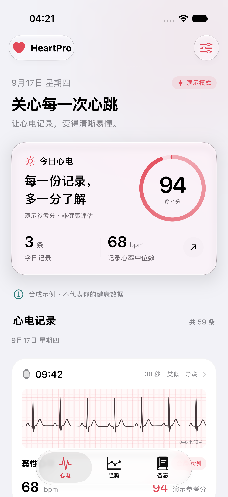

# HeartPro 0.1.0 开发预览验证

记录日期：2026-09-17 UTC。交付的是可运行的原生开发预览；目标功能的完整进度见[实现状态](../implementation-status.md)。本页截图与测试均使用合成数据，没有用户健康信息。

## 环境与结果

| 项目 | 实际结果 |
| --- | --- |
| 工程 | XcodeGen 生成 `HeartPro.xcodeproj`，HeartPro scheme |
| 编译器 | Xcode 27.0 / Swift 6.4，Swift 6 语言模式与严格并发检查 |
| 最低系统 | 配置为 iOS 18；运行验证为 iOS 27.0 |
| 设备 | iPhone 17 Simulator，arm64，iOS build 24A5390f |
| App 构建 | 模拟器构建与 build-for-testing 成功 |
| HeartProCore | Swift Testing，8 项通过，0 项失败 |
| App 测试 | XCTest / XCUITest，5 项通过，0 项失败，0 项跳过 |
| 配置检查 | HealthKit entitlement 与 PrivacyInfo.xcprivacy 通过 `plutil -lint` |
| 最终结果包 | `TestResults/FinalValidation.xcresult`；摘要为 [app-test-summary.json](./app-test-summary.json) |

结果包与 DerivedData 已加入忽略规则；截图和摘要单独保留在本目录。最终 App 测试运行约 39 秒。测试用 `--uitesting` 启动时采用内存数据库并关闭 UIKit 动画，正式运行保留系统动画。

## 实际覆盖

核心库的 8 项检查覆盖已知 NN 样本的 SDNN／RMSSD 数值、正向／反向合成 R 峰、无效与平直信号、采样缺口两侧不拼接 RR、降采样包络保留尖峰、真实数据不能生成演示分、空日与夏令时日期分组，以及演示数据的稳定性。公式通过不等于正常搏动识别通过，合成波形通过不等于临床准确率通过。

App 的 5 项检查如下：

1. 相同时间戳的 65 条记录按 30／30／5 分页，不重复、不丢失；重放导入保持幂等；源 ECG 删除保留本地笔记；同步 anchor 持久化。
2. 过期笔记版本不能覆盖新的笔记版本。
3. 60 秒 ECG 的 PDF 包含末尾 56–60 秒；长备忘跨页后仍包含终止标记，A4 宽度正确。600 次重复中文测试文本得到 6 页；视觉检查第一页与最后一页，正文未截断。尚未打印并用物理量尺核对。
4. 示例首页 → 单条 ECG 详情 → 添加「咖啡因」备忘 → 备忘 tab → 趋势 tab 的完整导航与保存流程。
5. 默认空态没有演示分；明确点击「先体验示例」后才显示数据；点击当日概览进入每日心电。

检查中修复了同时间记录排序和分页谓词的比较差异、概览卡片空白区域无法点击、首页标题截断以及长备忘分页。最终全套 App 回归通过。早期失败和中断的 xcresult 不作为通过证据。

## 实际界面

截图来自最终通过的 XCUITest，保持原始分辨率。界面采用珊瑚色重点信息、统一圆角与间距、原生玻璃导航／tab／概览，以及高对比 ECG 纸张。演示数据和演示参考分在页面中明确标记。

| 页面 | 截图 |
| --- | --- |
| 首次启动／深色 | [欢迎页](./screenshots/00-welcome.png) |
| 首页／浅色 | [当天概览与 ECG 列表](./screenshots/01-timeline.png) |
| ECG 详情／浅色 | [完整波形入口与记录总览](./screenshots/02-ecg-detail.png) |
| 备忘／浅色 | [已保存的快捷记录](./screenshots/03-journal.png) |
| 趋势／浅色 | [日周月年趋势入口](./screenshots/04-trends.png) |
| 每日心电／深色 | [日期切换与当日统计](./screenshots/05-daily.png) |



## 复现

```sh
rtk proxy xcodegen generate
rtk proxy swift test --package-path Packages/HeartProCore
rtk proxy xcodebuild -project HeartPro.xcodeproj -scheme HeartPro \
  -destination 'platform=iOS Simulator,name=iPhone 17' \
  -derivedDataPath DerivedData \
  -resultBundlePath TestResults/LocalValidation.xcresult \
  -parallel-testing-enabled NO -collect-test-diagnostics never \
  CODE_SIGNING_ALLOWED=NO test
```

`-resultBundlePath` 应使用尚不存在的路径。本环境在失败后的自动诊断清理阶段曾停滞，采用串行执行并关闭额外诊断收集；断言、结果和显式截图仍记录。`xcresulttool` 首次读取同一个结果包会建立缓存，因此摘要读取和附件导出依次执行。

直接使用 Xcode 运行 HeartPro 即可体验。首次打开选择「先体验示例」，或在 Run Arguments 加入 `--demo`；可使用 `--light`／`--dark` 检查主题。模拟器安装和运行无需配置开发团队；真机需配置自己的 Team 与 HealthKit 能力。

## 尚未验证或尚未开放

- 真实 Apple Watch 历史导入、设备锁定／权限变化／同步中断边界、系统 HRV 读取和症状写回必须真机核实。当前结果仅证明相关工程可编译，不能证明 HealthKit 实际数据完整性。
- 真实健康参考分、P／QRS／T 边界、PR／QT／QTc、PAC／PVC 等分类、可靠 NN 识别和自算 ECG HRV 尚未开放。研究性 R／RR／质量／离群点未通过真实 Watch 标注验证。
- 单导联 ECG 不能可靠识别或排除心梗、心肌缺血；本应用不输出相关诊断。所有结果仅供参考，不能用于医疗用途。
- iOS 18 材质回退、其他屏幕尺寸、最大辅助字体、VoiceOver 完整流程、万条历史性能、真实耗电和长时间后台行为未完成验收。
- 目前没有发布到 App Store，没有配置开发团队或执行真机签名，也没有上传健康数据到服务端。
