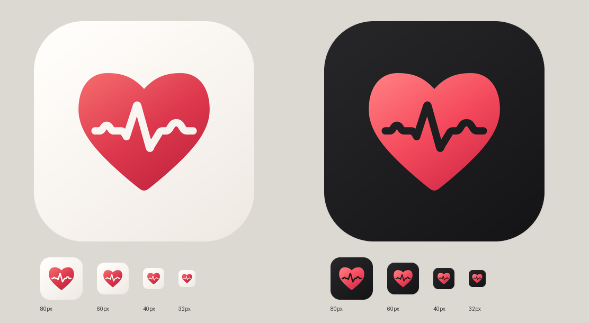

# HeartPro — 心电刻印

设计目标：第一眼识别心脏健康与心电记录，同时保持克制、精致的付费工具气质。

- 完整红色心形说明产品领域；心电线嵌于内部，两端不穿出边缘，保持外轮廓连续。
- 单一心形，不使用叠页、外描边或投影。波形的 P、T 段采用平滑弧线，主波峰承担小尺寸辨识。
- 暖白与石墨黑底色分别适配常规和深色桌面；同一轮廓保持识别一致。
- 不加文字、字母、医疗十字或额外装饰；不依靠小尺寸无法保留的纹理。



## 可复现源文件与应用资源

正式源文件为 `Tools/GenerateIcon.swift`；图形由 Core Graphics 贝塞尔路径绘制，使用 3 倍超采样后导出，不依赖在线图像生成服务。

```sh
rtk proxy swift Tools/GenerateIcon.swift HeartPro/Resources/Assets.xcassets/AppIcon.appiconset/AppIcon.png
```

输出是两张 1024 × 1024、不带透明通道的 sRGB PNG。资源目录 `Contents.json` 指定默认和 dark 外观。图像保持完整方形，由 iOS 应用圆角遮罩。

`cardiac-imprint-review-v2.png` 展示大图和 80、60、40、32 像素版本；圆角仅用于设计预览，并非模拟器截图。小尺寸以完整心形与主波峰为主要辨识特征。

应用左上角使用相同路径和配色导出的透明矢量 Logo，搭配 HeartPro 字标，不带图标底板或工具栏玻璃胶囊。`BrandMark.imageset` 包含浅色／深色 PDF，保留矢量缩放；心电镂空透出当前页面背景。重新生成：

```sh
rtk proxy swift Tools/GenerateIcon.swift --brand-mark HeartPro/Resources/Assets.xcassets/BrandMark.imageset
```

当前目录中的其他生成脚本与图片是设计探索，应用不引用它们。原始图标和原始生成脚本已备份为 `AppIconPrevious.png`、`GenerateIconPrevious.swift`。

## 验证

- 两张资源均已检查为 1024 × 1024、RGB 无透明通道，PNG 声明 sRGB 色彩空间。
- 预览使用的源图片与应用中的正式 PNG 字节一致；已目视检查大图与 32–80 像素缩放图。
- `xcodebuild -project HeartPro.xcodeproj -scheme HeartPro -configuration Debug -sdk iphonesimulator -destination 'generic/platform=iOS Simulator' -derivedDataPath DerivedData CODE_SIGNING_ALLOWED=NO build` 通过，包含 AppIcon 资源编译。
- 未进行真机桌面检查或用户辨识度、购买意愿测试。
