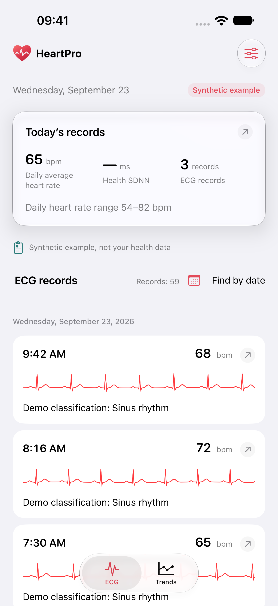
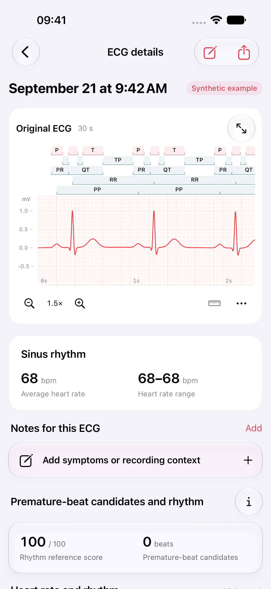
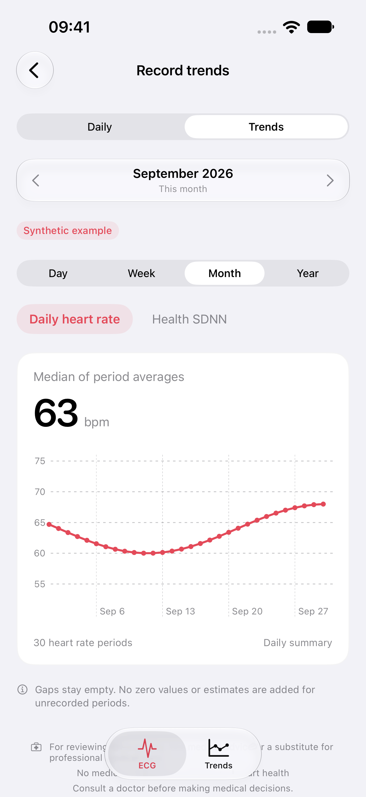

<p align="center">
  <picture>
    <source media="(prefers-color-scheme: dark)" srcset="HeartPro/Resources/Assets.xcassets/AppIcon.appiconset/AppIconDark.png">
    
  </picture>
</p>
<h1 align="center">HeartPro</h1>
<p align="center">Your ECG records, waveforms and heart trends. On your device.</p>
<p align="center">
  <a href="https://heartpro.alkinum.com">Website</a> ·
  <a href="https://heartpro.alkinum.com/docs/">Guide</a> ·
  <a href="https://heartpro.alkinum.com/release/">Availability</a> ·
  <a href="LICENSE">GPL-3.0-or-later</a>
</p>
<p align="center">iPhone &amp; iPad · iOS 18+ · Swift 6 · Six languages</p>

<p align="center">
  
  
  
</p>
<p align="center"><sub>Native simulator captures from 0.6.0 (4), using labelled synthetic data.</sub></p>

## What it does

- Browse Apple Health ECG history, daily summaries, heart rate and HRV trends.
- Inspect full waveforms with zoom, landscape view, two-point measurements and beat annotations.
- Keep notes with each recording and export PDF reports. Selected symptoms can be saved as separate Apple Health entries; original ECGs remain read-only.
- Explore local signal-quality checks, interval estimates, short-recording HRV and rhythm candidates, with explicit missing values and method explanations.

Built with SwiftUI, HealthKit, SwiftData and Swift Charts. Analysis and health records stay on device, with no account, analytics SDK or remote analysis service. Try the built-in synthetic examples without Health access. Supports English, Simplified Chinese, Japanese, Korean, German and Spanish.

**For personal record review and research.** Automatic estimates have not undergone independent accuracy validation on real Apple Watch recordings. They are not diagnoses, health scores or emergency alerts. See [methods and limitations](https://heartpro.alkinum.com/docs/methods/).

## Build

Requires macOS, Xcode 26 or later and [XcodeGen](https://github.com/yonaskolb/XcodeGen). The checked-in project targets iOS 18+; current development uses Xcode 27. Repository shell commands use [RTK](https://github.com/rtk-ai/rtk).

```sh
rtk proxy python3 Tools/install_hooks.py
rtk proxy xcodegen generate
rtk proxy open HeartPro.xcodeproj
```

Run the **HeartPro** scheme on an iPhone or iPad simulator, acknowledge the usage notice, then choose **Try examples first**. For a physical device, use your own signing team and unique bundle identifier, and enable HealthKit for that identifier. Keep changes in `project.yml` when regenerating the project. Signing credentials and production website secrets are not included or needed for the simulator.

## Check

```sh
rtk proxy swift test --package-path Packages/HeartProCore
rtk proxy python3 Tools/localization.py --check
rtk proxy python3 Tools/check_entitlements.py
rtk proxy python3 Tools/guard.py tracked
```

App and UI tests require an available simulator; replace the destination below with one installed in Xcode.

```sh
rtk proxy xcodebuild -project HeartPro.xcodeproj -scheme HeartPro \
  -destination 'platform=iOS Simulator,name=iPhone 17' \
  -derivedDataPath DerivedData -parallel-testing-enabled NO \
  -collect-test-diagnostics never CODE_SIGNING_ALLOWED=NO test
```

## Explore the source

| Path | Contents |
| --- | --- |
| [HeartPro](HeartPro) | Native app, HealthKit access, local storage, UI and PDF export |
| [HeartProCore](Packages/HeartProCore) | Deterministic Swift analysis, models, synthetic fixtures and tests; no third-party packages |
| [website](website) | Bilingual SvelteKit / svedocs site and server-side support intake |
| [Localization](Localization/README.md) | Shared six-language resources and generation workflow |
| [Tools](Tools) | Validation, packaging and reproducible brand artwork |

[Contributing](CONTRIBUTING.md) · [Security](SECURITY.md) · [Development standards](.agents/skills/heartpro-guard/SKILL.md)

## License

Copyright (C) 2026 HeartPro contributors.

HeartPro's original source, documentation and artwork are licensed under the **GNU General Public License, version 3 or any later version**, without warranty. See [LICENSE](LICENSE) and [licensing notes](LICENSING.md). Third-party components and external reference material retain their own terms; see [third-party notices](THIRD_PARTY_NOTICES.md).
